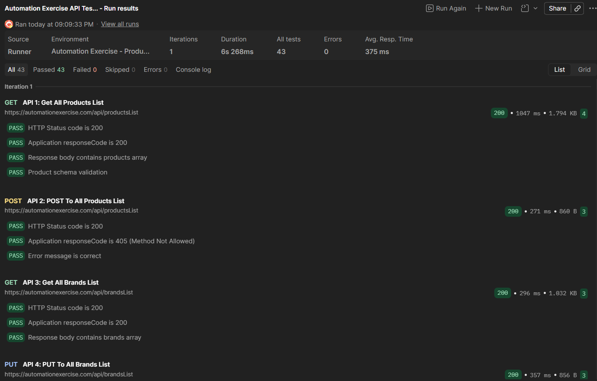
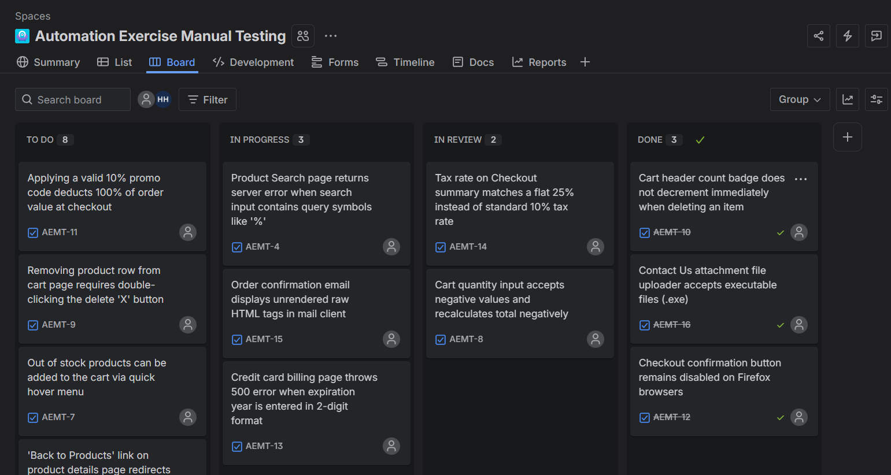
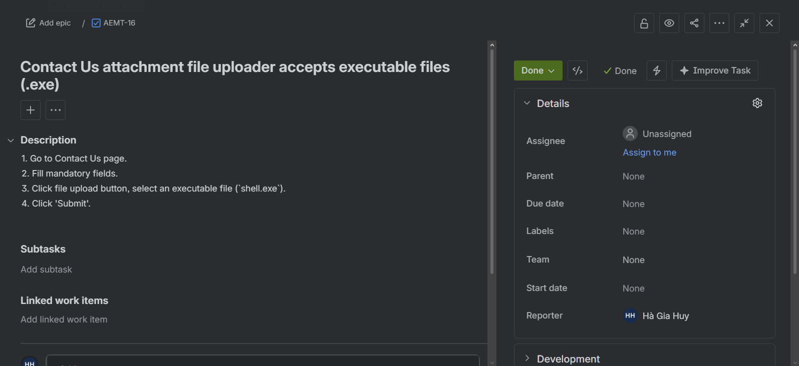

# Manual & API Testing Practice: E-Commerce Web Application (Automation Exercise)

[](https://automationexercise.com/)
[](#)
[](#)
[](#)
[](#)
[](#)
[](#)

A comprehensive Quality Assurance and end-to-end testing project targeting the live e-commerce web platform **[Automation Exercise](https://automationexercise.com)**. 

This repository implements a complete, structured software testing lifecycle: from **Lightweight Test Planning** and **Formal ISTQB Test Design Techniques** (Equivalence Partitioning, Boundary Value Analysis, Decision Tables, State Transitions) to **Defect Governance**, **Defect Proof Capture**, and **Automated REST API Contract Assertions**.

---

## 🔗 Live Deliverables & Interactive Links
* 📊 **[Interactive Google Sheets Test Cases & Defect Suite](https://docs.google.com/spreadsheets/d/1yiyinIh0wybSdaX7NRvY4mFZIWfkzaT6/edit?usp=sharing&ouid=100062310304020489867&rtpof=true&sd=true)** — View the live 54 test cases matrix with color-coded execution states and defect management log online.
* 📄 **[Official Software Test Plan (PDF)](docs/TestPlan_AutomationExercise.pdf)** — Executive IEEE-829 lightweight test plan covering In-Scope & Out-of-Scope rationale, quality gates, and SLA defect governance.

---

## 🎯 Core Project Deliverables

| Deliverable Artifact | Formats | Location in Repository | Highlights |
| :--- | :---: | :--- | :--- |
| 📄 **Lightweight Software Test Plan (STP)** | **PDF & Word (`.docx`)** | [docs/TestPlan_AutomationExercise.pdf](docs/TestPlan_AutomationExercise.pdf)<br>[docs/TestPlan_AutomationExercise.docx](docs/TestPlan_AutomationExercise.docx) | Executive IEEE-829 lightweight test plan covering In-Scope, Out-of-Scope rationale, ISTQB test techniques, Quality Gates, and SLA governance. |
| 📊 **Master QA Test & Defect Workbook** | **Excel (`.xlsx`)** & **Google Sheets** | [testcases/AutomationExercise_Test_Suite.xlsx](testcases/AutomationExercise_Test_Suite.xlsx)<br>[Online Google Sheets](https://docs.google.com/spreadsheets/d/1yiyinIh0wybSdaX7NRvY4mFZIWfkzaT6/edit?usp=sharing&ouid=100062310304020489867&rtpof=true&sd=true) | Formatted 3-sheet workbook: **Summary Dashboard**, **Test Cases Matrix** (all 12 fields including Test Data & Defect links), and **Defect Management Sheet** (with Severity & Evidence paths). |
| 🐞 **Defect Management & Bug Tracking** | **Markdown** & **CSV** | [test-artifacts/bug-reports.md](test-artifacts/bug-reports.md)<br>[test-artifacts/bug-reports.csv](test-artifacts/bug-reports.csv) | 16 logged defects complete with reproduction steps, test data, actual results, severity/priority, and linked test case references. |
| 📸 **Defect Proof & Evidence Gallery** | **PNG Images** | [evident/bugs/](evident/bugs/) | 16 live browser screenshots captured via Puppeteer MCP indexed by Bug ID (`BUG-001` through `BUG-016`). |
| 🧪 **Backend REST API Test Suite** | **Postman Collection** | [api-testing/AutomationExercise_API.postman_collection.json](api-testing/AutomationExercise_API.postman_collection.json) | 14 API requests covering 10+ backend routes with 43 automated JavaScript assertions. |

---

## 📊 Test Execution Dashboard

### 1. Test Case Execution Summary
*   **Total Test Cases Designed:** 54
*   **Total Test Cases Executed:** 54 (100% execution rate)
*   **Passed Test Cases:** 38
*   **Failed Test Cases:** 16
*   **Overall Pass Rate:** $\approx 70.37\%$

```
[███████████████████████████████████████                     ] 70.37% (Passed)
```

| Module / Feature Area | Designed | Executed | Passed | Failed | Pass Rate | Linked Defects |
| :--- | :---: | :---: | :---: | :---: | :---: | :--- |
| **Registration & Account Management** | 10 | 10 | 8 | 2 | 80.0% | BUG-001, BUG-002 |
| **Login & Logout** | 10 | 10 | 9 | 1 | 90.0% | BUG-003 |
| **Product Catalog & Search** | 10 | 10 | 7 | 3 | 70.0% | BUG-004, BUG-005, BUG-006 |
| **Shopping Cart & Cart Actions** | 10 | 10 | 6 | 4 | 60.0% | BUG-007, BUG-008, BUG-009, BUG-010 |
| **Checkout, Billing & Payments** | 12 | 12 | 6 | 6 | 50.0% | BUG-011, BUG-012, BUG-013, BUG-014, BUG-015 |
| **General & Contact Us** | 2 | 2 | 1 | 1 | 50.0% | BUG-016 |
| **TOTAL** | **54** | **54** | **38** | **16** | **70.37%** | **16 Defects Mapped** |

### 2. Defect Severity & Priority Distribution
A total of **16 defects** were identified, documented, and cross-referenced with failing test cases.

| Severity / Priority | High (P1) | Medium (P2) | Low (P3) | Total Defects | % Share |
| :--- | :---: | :---: | :---: | :---: | :---: |
| 🚨 **Critical (S1)** | 4 | 0 | 0 | **4** | 25.0% |
| 🔴 **High (S2)** | 4 | 2 | 0 | **6** | 37.5% |
| 🟡 **Medium (S3)** | 0 | 3 | 0 | **3** | 18.75% |
| 🔵 **Low (S4)** | 0 | 0 | 3 | **3** | 18.75% |
| **Total** | **8** | **5** | **3** | **16** | **100.0%** |

---

## 🧠 Applied ISTQB Test Design Techniques

Test cases are systematically designed and executed using formal ISTQB Black-Box test design techniques:

1.  **Equivalence Partitioning (EP):**
    *   *Email syntax:* Valid format (`name@domain.com`) vs Invalid missing `@` vs Invalid missing domain vs Duplicate database email.
    *   *Contact Us upload:* Valid document partition (`.png`, `.pdf`) vs Executable binary partition (`.exe`) $\rightarrow$ Uncovered **BUG-016** (unrestricted `.exe` upload).
2.  **Boundary Value Analysis (BVA):**
    *   *Password length:* Boundary threshold at 6 characters. Validated 5 characters (Rejected) vs 6 characters (Accepted).
    *   *Cart quantity inputs:* Negative boundary `-2` and `0` $\rightarrow$ Uncovered **BUG-008** (negative cart total calculation).
    *   *Payment expiration year:* 2-digit `28` vs 4-digit `2028` $\rightarrow$ Uncovered **BUG-013** (server crash on 2-digit format).
3.  **Decision Table Testing:**
    *   *Checkout authorization & promo math:* Evaluated `[User Logged In?]` $\times$ `[Cart Count > 0?]` $\times$ `[Promo Code Valid?]` $\rightarrow$ Uncovered **BUG-011** (10% promo code incorrectly deducted 100% of order value for free).
4.  **State Transition Testing:**
    *   *Session & Cart lifecycle:* Guest $\rightarrow$ Cart populated $\rightarrow$ Authenticate $\rightarrow$ Checkout $\rightarrow$ Payment confirmed $\rightarrow$ Logout invalidation.
5.  **Adversarial & Error Guessing:**
    *   SQL Injection vectors (`' OR '1'='1` in Name $\rightarrow$ Uncovered **BUG-002** exposing raw SQL error).
    *   URL encoding special characters (`%` in search query $\rightarrow$ Uncovered **BUG-004** throwing HTTP 500).
    *   Double-click race condition on cart delete button $\rightarrow$ Uncovered **BUG-009**.

---

## 📂 Repository Structure & Artifacts

```
├── docs/
│   ├── TestPlan_AutomationExercise.pdf             <-- Official Software Test Plan (PDF Deliverable)
│   └── TestPlan_AutomationExercise.docx            <-- Source Word document (.docx)
├── testcases/
│   └── AutomationExercise_Test_Suite.xlsx          <-- Master Excel Workbook (Dashboard + TCs + Defects)
├── evident/
│   └── bugs/                                       <-- 16 High-Res Defect Proof Screenshots (BUG_001 to BUG_016)
├── test-artifacts/
│   ├── test-plan.md                                <-- Markdown version of Software Test Plan
│   ├── test-cases.md                               <-- 54 test cases formatted in Markdown
│   ├── test-cases.csv                              <-- 12-column CSV test matrix for Google Sheets/Excel import
│   ├── bug-reports.md                              <-- 16 detailed bug reports
│   ├── bug-reports.csv                             <-- Defect list CSV for Jira/Trello import
│   ├── jira_board.png                              <-- Jira Kanban board simulation screenshot
│   └── jira_ticket.png                             <-- Jira bug ticket detail screenshot
├── api-testing/
│   ├── README.md                                   <-- Instructions to import and run Postman tests
│   ├── AutomationExercise_API.postman_collection.json <-- 14 requests with 43 JS assertions
│   ├── AutomationExercise_Env.postman_environment.json<-- Collection environment variables
│   └── postman_run.png                             <-- Screenshot of 100% passing Postman test runner
└── README.md                                       <-- (You are here) Executive dashboard & summary
```

---

## 📋 Master Test Cases Structure

Each of the 54 test cases contains complete enterprise-grade fields:
1.  **TC ID:** Unique identifier (e.g., `TC-REG-001`, `TC-CHK-005`).
2.  **Title:** Clear, action-oriented test summary.
3.  **Module:** Feature area grouping.
4.  **Priority:** High (P1), Medium (P2), Low (P3).
5.  **Type:** Applied test technique (e.g., *Functional - Positive*, *Boundary Value Analysis*, *Security - SQLi*).
6.  **Preconditions:** Required initial application and data state.
7.  **Test Data:** Concrete input parameters, mock card details, and boundary values.
8.  **Steps:** Clear, numbered step-by-step reproduction sequence.
9.  **Expected Result:** Verifiable expected behavior compliant with requirements.
10. **Actual Result:** Precise observed behavior during execution.
11. **Status:** `Pass` or `Fail` (color-coded in Excel).
12. **Defect ID:** Linked bug identifier (e.g., `BUG-001`) or `-` for passing cases.

---

## 🐞 Defect Management Structure

The Defect Management sheet provides a clean, focused bug-tracking format containing:
*   **Defect ID** (e.g., `BUG-001` to `BUG-016`)
*   **Title / Summary**
*   **Module**
*   **Severity** (Critical, High, Medium, Low)
*   **Priority** (High (P1), Medium (P2), Low (P3))
*   **Status** (Open)
*   **Preconditions**
*   **Steps to Reproduce**
*   **Test Data**
*   **Expected Result vs Actual Result**
*   **Evidence Screenshot Path** (referenced to `evident/bugs/`)
*   **Linked TC ID** (positioned as the final reference column)

---

## 🧪 Automated API Test Run

The Postman API test suite was executed against the production environment of the SUT. All 43 assertions passed successfully, validating HTTP response codes (200, 400, 404), response latency, and JSON schema integrity:



---

## 📋 Jira Defect Tracking Board

All 16 defects discovered during testing have been successfully documented, managed, and tracked using a custom Kanban board in **Jira Software**:

### 1. Active Kanban Board


### 2. Mapped Jira Ticket Detail


---

## 🌟 References & Links
*   **Target Web Application:** [Automation Exercise](https://automationexercise.com)
*   **API Documentation:** [Automation Exercise API List](https://automationexercise.com/api_list)
*   **Testing Tool:** [Postman](https://www.postman.com/)
