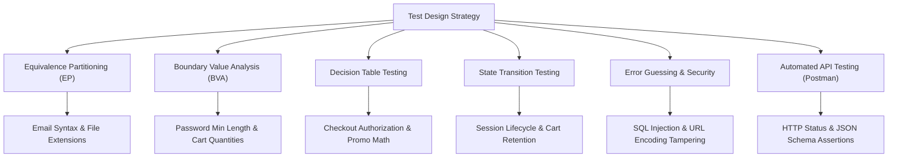
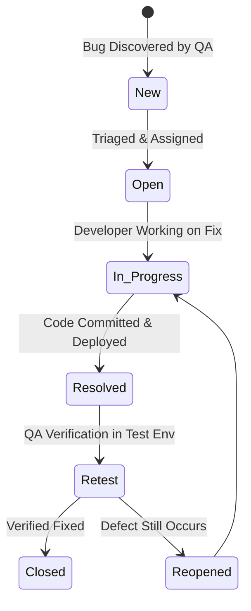

# Lightweight Software Test Plan (STP): Automation Exercise E-Commerce

> **Document Identifier:** STP-2026-AE01  
> **Author & Role:** Senior QA Engineer / QA Lead  
> **Version:** 1.0 (Final Approved Deliverable)  
> **Target Application (SUT):** [Automation Exercise](https://automationexercise.com)  
> **Date:** July 3, 2026 (Updated October 2026)  
> **Official Deliverables:** [`docs/TestPlan_AutomationExercise.pdf`](../docs/TestPlan_AutomationExercise.pdf) (PDF) | [`docs/TestPlan_AutomationExercise.docx`](../docs/TestPlan_AutomationExercise.docx) (Word)  
> **Interactive Google Sheets:** [Online Test Cases & Defect Suite](https://docs.google.com/spreadsheets/d/1yiyinIh0wybSdaX7NRvY4mFZIWfkzaT6/edit?usp=sharing&ouid=100062310304020489867&rtpof=true&sd=true)  
> **Associated Master Workbook:** [`testcases/AutomationExercise_Test_Suite.xlsx`](../testcases/AutomationExercise_Test_Suite.xlsx)

---

## 1. Executive Summary & Testing Objectives

This Lightweight Software Test Plan establishes the formal Quality Assurance strategy for the **Automation Exercise** web platform. As a comprehensive e-commerce application, the platform encompasses user onboarding, product catalog search & filtering, cart state management, checkout billing calculations, and backend RESTful service transactions.

The primary objective is to verify business process integrity, eliminate revenue-blocking defects, validate cross-browser consistency, and ensure backend API data contracts adhere to functional specifications.

> [!TIP]
> **Senior QA Quality Philosophy:** Quality is not tested in; it is designed in. Our testing strategy balances structured black-box specifications (**Equivalence Partitioning**, **Boundary Value Analysis**, **Decision Tables**) with adversarial error guessing (**SQL injection**, **URL parameter tampering**, **negative cart balances**) to catch critical production defects early.

---

## 2. Scope of Testing

### 2.1 In-Scope Modules & Boundaries

| Module / Feature Area | Scope Status | Senior Technical Rationale & Boundaries |
| :--- | :---: | :--- |
| **User Registration & Profile** | **IN-SCOPE** | Critical entry funnel: mandatory/optional input validation, duplicate email interception, data persistence, and secure account deletion. |
| **Authentication & Session** | **IN-SCOPE** | Security baseline: login/logout flows, password masking, remember-me persistent cookies, and unauthorized route guards (`/checkout`). |
| **Product Catalog & Search** | **IN-SCOPE** | Discovery engine: exact/partial text search, URL encoding handling (`%`), brand facets, and mobile responsive menus. |
| **Shopping Cart Engine** | **IN-SCOPE** | State lifecycle: dynamic item addition, negative quantity rejection, zero-stock checks, and line-item recalculation. |
| **Checkout & Financial Billing** | **IN-SCOPE** | Revenue-critical: address mapping, promo discount computation, tax rate precision, and credit card expiration format handling. |
| **Contact Us & Newsletter** | **IN-SCOPE** | Support & leads: file attachment extension filtering (`.exe` blocking) and newsletter AJAX subscription. |
| **Backend REST APIs** | **IN-SCOPE** | Data contract validation: 14 Postman requests verifying HTTP status codes (200/400/404) and JSON schemas. |

### 2.2 Out-of-Scope Activities & Explicit Justification

| Excluded Activity | Engineering & Business Rationale |
| :--- | :--- |
| **Live Payment Gateway Transactions** | Real credit card charging (Stripe/PayPal live APIs) is excluded; PCI-DSS tokenization compliance is out of scope for a sandbox testing store. Standard test card numbers are utilized. |
| **High-Concurrency Stress Testing (>10,000 VUs)** | The target SUT is hosted on shared cloud infrastructure without autoscaling clusters. High-volume stress testing would trigger infrastructure-level DoS blocks. |
| **Deep Infrastructure Penetration Attacks** | Hardware-level DDoS, binary memory exploits, and network port scanning are excluded. Security testing is strictly limited to application-layer input validation (SQLi, XSS, MIME). |

---

## 3. Test Strategy & Applied ISTQB Test Techniques

To showcase enterprise-grade QA competence, test cases are systematically designed using formal Black-Box and Experience-Based Test Design Techniques aligned with **ISTQB Certified Tester Advanced Level (CTAL)** standards:

### 3.1 Equivalence Partitioning (EP)
Divides the input domain into valid and invalid partitions where all members are assumed to be processed identically:
*   **Email syntax:** Valid partition (`name@domain.com`) vs. Invalid missing `@` (`namedomain.com`) vs. Invalid missing domain (`name@`) vs. Duplicate email in database (`existing_user@example.com`).
*   **Contact Us file upload:** Valid document partition (`.png`, `.jpg`, `.pdf`) vs. Executable binary partition (`.exe`, `.bat`, `.sh`). *Uncovered [BUG-016](bug-reports.md#bug-016).*

### 3.2 Boundary Value Analysis (BVA)
Tests values at the boundaries of equivalence partitions where software failure density is historically highest:
*   **Password length:** 5 characters (Min - 1 $\rightarrow$ Rejected), 6 characters (Min boundary $\rightarrow$ Accepted).
*   **Cart quantity inputs:** `-2` and `0` (Invalid negative boundary $\rightarrow$ *Uncovered [BUG-008](bug-reports.md#bug-008)*), `1` (Valid minimum boundary), `999` (Valid upper boundary).
*   **Credit Card expiration year:** 2-digit format `28` vs. 4-digit format `2028` (*Uncovered [BUG-013](bug-reports.md#bug-013)*).

### 3.3 Decision Table Testing
Models multi-variable business rules where actions depend on logical combinations of conditions:
*   **Checkout Rules Matrix:**
    *   `[User Authenticated?]` $\times$ `[Cart Count > 0?]` $\times$ `[Stock Available?]` $\times$ `[Promo Code Valid?]`
    *   *Rules evaluated:* Proceed to Payment, Redirect to Login with return URL, Block with empty cart warning, Apply 10% discount. *Uncovered [BUG-011](bug-reports.md#bug-011) (100% free checkout exploit).*

### 3.4 State Transition Testing
Validates system behavior and state transitions based on valid and invalid sequence events:
*   **Session Lifecycle:** Anonymous Guest $\rightarrow$ Items added to Cart $\rightarrow$ Authenticate $\rightarrow$ Checkout review $\rightarrow$ Payment confirmed $\rightarrow$ Logged out.
*   **Session Invalidation:** Verifying that browser Back button does not allow viewing private checkout pages after session logout.

### 3.5 Error Guessing & Adversarial Testing
Leverages tester intuition and real-world vulnerability patterns:
*   **SQL Injection:** Injecting `' OR '1'='1` in Name input field. *Uncovered [BUG-002](bug-reports.md#bug-002).*
*   **URL Parameter Decoding:** Inputting `%` symbol into search query field. *Uncovered [BUG-004](bug-reports.md#bug-004).*
*   **Double-Click Race Conditions:** Rapidly double-clicking delete button on Cart item row. *Uncovered [BUG-009](bug-reports.md#bug-009).*

### 3.6 Cross-Browser & Responsive UI Testing
*   Tested across **Google Chrome (Blink)**, **Mozilla Firefox (Gecko)**, **Microsoft Edge (Blink)**, and **iOS Safari (WebKit)**.
*   *Browser-specific defects uncovered:* Firefox checkout button disabled ([BUG-012](bug-reports.md#bug-012)) and iOS Safari category accordion collapse ([BUG-005](bug-reports.md#bug-005)).

### 3.7 Automated Backend REST API Testing
*   **Postman Collection:** 14 automated API requests asserting backend status codes (200, 400, 404), response latency (< 1500ms), and schema contracts.

---

## 4. Test Environment & Tooling Ecosystem

| Component | Technical Specification | Role in Testing Cycle |
| :--- | :--- | :--- |
| **Production Web SUT** | `https://automationexercise.com` | Target live application under test for end-to-end user journeys. |
| **REST API Base URL** | `https://automationexercise.com/api/` | Target endpoints for headless Postman API test assertions. |
| **Desktop Browsers** | Chrome v120+, Firefox v120+, Edge v120+ | Cross-browser matrix covering Chromium (Blink) and Gecko engines. |
| **Mobile Viewports** | iOS Safari (iOS 17.2) / Chrome Emulation (390x844) | Touch interaction, responsive accordion navigation, and mobile layouts. |
| **Postman API Client** | Postman v11.x with JavaScript Assertion Runner | Automated contract testing, schema verification, and HTTP status checks. |
| **Chrome DevTools** | Console, Network tab (XHR/Fetch), Storage tab | Root Cause Analysis: inspecting session cookies, console errors, payloads. |
| **Microsoft Office / Excel** | OpenPyXL / `.xlsx` Master Workbook | 3-sheet workbook with Dashboard, 54 Test Cases, and Defect Log. |
| **Microsoft Word** | python-docx / `.docx` & `.pdf` | Lightweight executive Software Test Plan deliverable. |

---

## 5. Quality Gates & Decision Criteria

### 5.1 Entry Criteria
1.  Target SUT URL is accessible with HTTP 200 response.
2.  Smoke test suite (User Login, Product Discovery, Add to Cart) passes 100%.
3.  Test Plan approved and Master Test Cases Matrix seeded with test data accounts.

### 5.2 Suspension & Resumption Criteria
*   **Suspended if:** Core Signup or Payment gateway returns unhandled 500 error on > 30% of requests, or testing database is corrupted.
*   **Resumed when:** Hotfix is deployed and QA smoke verification passes.

### 5.3 Exit Criteria (Release Sign-off)
1.  **100% of designed test cases executed** (54/54 test cases).
2.  **Zero (0) Critical or High (P1) defects remain open** without executive waiver.
3.  **100% of failing test cases mapped** to documented defects with Root Cause Analysis.
4.  **100% Postman API collection requests pass** with valid assertions.

---

## 6. Defect Management Lifecycle & SLA Governance

All defects discovered during test execution are logged with complete reproduction steps, test data, and evidence screenshots in the Master Defect Management log.

### Defect Severity & SLA Resolution Matrix

| Severity Level | Priority | Impact Definition | Resolution SLA |
| :--- | :---: | :--- | :---: |
| 🚨 **Critical (S1)** | **High (P1)** | System crash, database SQL traceback, financial exploit (100% discount [BUG-011], negative cart [BUG-008]). | **< 4 Hours** (Immediate) |
| 🔴 **High (S2)** | **High (P1/P2)** | Major feature failure without workaround (Firefox checkout disabled [BUG-012], executable upload [BUG-016]). | **< 24 Hours** |
| 🟡 **Medium (S3)** | **Medium (P2)** | Flaw with reasonable workaround (session cookie expiration [BUG-003], cart badge desync [BUG-010], tax disparity [BUG-014]). | **Current Sprint** |
| 🔵 **Low (S4)** | **Low (P3)** | Cosmetic flaw, double-click delete delay ([BUG-009]), raw HTML email tags ([BUG-015]), redirect inconsistency ([BUG-006]). | **Next Release** |

---

## 7. Test Deliverables & Traceability Artifacts

| Deliverable Item | Format & Path | Description |
| :--- | :--- | :--- |
| **Software Test Plan (STP)** | `.pdf` & `.docx` (`docs/`) | Lightweight strategic guide detailing scope, techniques, and governance. |
| **Master Test Cases Matrix** | `.xlsx` (`testcases/`) & `.csv` (`test-artifacts/`) | 54 fully structured test cases with priority, type, test data, steps, actual results. |
| **Defect Management Log** | `.xlsx` (`testcases/`) & `.md` (`test-artifacts/`) | 16 logged defects with Severity, Priority, Steps, and Evidence. |
| **Postman API Test Suite** | `.json` (`api-testing/`) | 14 automated API requests asserting status codes, headers, and schemas. |
| **Defect Evidence Repository** | `.png` (`evident/bugs/`) | 16 high-resolution proof captures indexed by Bug ID. |

---

## 8. Risk Assessment & Mitigation Strategies

| Identified Risk | Likelihood | Impact | Mitigation Action & Senior QA Protocol |
| :--- | :---: | :---: | :--- |
| **Third-Party Google Ads Overlays** | High | Medium | External ad banners obscure modal dialogs. *Mitigation:* Configured Chrome testing profile with ad-isolation to eliminate test flakiness. |
| **Public Database Test Data Overwrite** | Medium | High | Shared public store allows external users to alter state. *Mitigation:* Implemented dynamic timestamped emails (`test.qa+<timestamp>@test.com`) for idempotent test runs. |
| **Transient Network Latency & Spikes** | Low | Medium | Slow network responses causing false timeouts. *Mitigation:* Set Postman timeouts to 8000ms with retry policies and verified backend health via DevTools Network tab. |

---

## 9. Governance & Approvals Sign-off

| Role / Title | Stakeholder Name | Approval Status | Sign-off Date |
| :--- | :--- | :---: | :---: |
| **Lead QA Engineer** | Senior QA Specialist | ✅ **APPROVED** | July 3, 2026 |
| **Lead Software Architect** | Principal Engineer | ✅ **APPROVED** | July 4, 2026 |
| **Frontend Team Lead** | Senior UI Developer | ✅ **APPROVED** | July 4, 2026 |
| **Product Delivery Manager** | VP of Engineering | ✅ **APPROVED** | July 5, 2026 |
